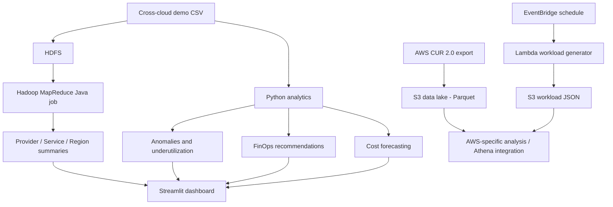

# Cloud Cost Optimization Analytics Using Hadoop

A cloud FinOps analytics project combining an Apache Hadoop MapReduce implementation, Python-based analytics and forecasting, an interactive Streamlit dashboard, and AWS data-ingestion infrastructure.

> **Data integrity note:** The cross-cloud CSV dataset (AWS/Azure/GCP) is synthetic/demo data unless explicitly noted otherwise. AWS Cost and Usage Report (CUR 2.0) Parquet objects in the configured AWS S3 data lake are a separate source of real AWS billing data. Do not present synthetic cross-cloud totals, anomaly counts, forecasts, or savings estimates as actual AWS charges or achieved savings.

## Project goals

- Analyze cloud costs by provider, service, region, and usage attributes.
- Process grouped cost records using a Hadoop MapReduce Java job.
- Detect unusually expensive records and underutilized resources.
- Generate explainable FinOps recommendations and potential-savings scenarios.
- Forecast future cost values using model-based analysis.
- Display results in a dashboard.
- Provision repeatable AWS infrastructure with Terraform and ingest AWS CUR 2.0 data to S3.
- Run a scheduled Lambda workload that emits workload telemetry to S3 for analytics exercises.

## Architecture



The local synthetic-data analytics and the AWS data pipeline are related demonstrations, but they are not automatically the same dataset. The diagram shows intended integration points; only mark a stage as end-to-end validated when the corresponding run evidence is available.

## Technology stack

- **Big data:** Apache Hadoop 3.2.2, HDFS, MapReduce, Java
- **Analytics:** Python, Pandas, scikit-learn, Jupyter
- **Visualization:** Streamlit and plotting libraries
- **AWS:** S3, AWS Billing Data Exports / CUR 2.0, Lambda, EventBridge, RDS PostgreSQL, CloudWatch, IAM, VPC, EC2/Systems Manager
- **Infrastructure as code:** Terraform
- **Source control:** Git and GitHub

## Repository layout

```text
.
├── data/
│   ├── raw/                 # Demo cross-cloud dataset
│   └── processed/           # Processed demo records
├── hadoop/
│   ├── CloudCostDriver.java
│   ├── CloudCostMapper.java
│   ├── CloudCostReducer.java
│   └── cloud-cost-analysis.jar
├── notebooks/
│   └── cloud_cost_analysis.ipynb
├── results/                 # Generated analysis outputs and summaries
├── src/
│   ├── anomaly_detection.py
│   ├── cloud_cost_analysis.py
│   ├── dashboard.py
│   ├── finops_recommendation_engine.py
│   ├── generate_dataset.py
│   ├── hadoop_output_processor.py
│   ├── ml_cost_prediction.py
│   ├── provider_recommendation_engine.py
│   ├── recommendation_engine.py
│   └── underutilization_detector.py
└── terraform/               # AWS infrastructure definitions
```

## Run the local Python analysis

Use Python 3.10+ (the working development environment for this project was Python 3.12). From the repository root in PowerShell:

```powershell
python -m venv .venv
.\.venv\Scripts\Activate.ps1
python -m pip install --upgrade pip
python -m pip install -r requirements.txt
python -m compileall src
```

Run the main analysis script:

```powershell
python src/cloud_cost_analysis.py
```

Run the dashboard:

```powershell
streamlit run src/dashboard.py
```

Some scripts may expect pre-generated files under `data/` or `results/`. Check each script's input/output paths before rerunning a pipeline. Existing result files are included so outputs can be inspected even when a full processing run is unavailable.

## Hadoop MapReduce (Windows local setup)

Hadoop on Windows depends on a compatible Java installation and the local Hadoop configuration. Set paths explicitly in the same PowerShell session:

```powershell
$env:JAVA_HOME = 'C:\Java\jdk17'
$env:HADOOP_HOME = "$env:USERPROFILE\OneDrive\Desktop\BigData\hadoop-3.2.2"
$env:HADOOP_CONF_DIR = "$env:HADOOP_HOME\etc\hadoop"
$env:PATH = "$env:JAVA_HOME\bin;$env:HADOOP_HOME\bin;$env:HADOOP_HOME\sbin;$env:PATH"
java -version
hadoop version
```

Start HDFS only after confirming configured NameNode metadata and directories. **Never run `hdfs namenode -format` on an existing data directory**: it can invalidate access to existing HDFS data. Start and verify the ResourceManager and NodeManager before submitting MapReduce. A MapReduce CSV already in `results/` is a stored artifact; it is not by itself proof that a fresh YARN run succeeded.

## AWS and Terraform

Terraform configuration is under `terraform/`. Review resource names, region, IAM permissions, state, and current AWS resources before applying changes.

Safe review commands (from the `terraform` directory):

```powershell
terraform fmt -check -recursive
terraform validate
terraform plan
```

Do not run `terraform destroy` as a troubleshooting step. Do not commit `terraform.tfstate`, `terraform.tfstate.backup`, `.tfvars` containing secrets, AWS credentials, database passwords, private keys, or local environment files. Keep Terraform state and generated secret material private.

The configured AWS pipeline uses a CUR 2.0 export to S3 in Parquet format, and a scheduled Lambda workload writes JSON telemetry to an S3 analytics prefix. CUR delivery has a delay; check billing-period and refresh metadata before interpreting totals. RDS and other managed services can continue incurring costs while idle. Verify current resources in the AWS Console and stop only project resources that are safe to stop.

## Demo dataset snapshot

The committed synthetic demo CSV currently contains **15,000 records**. The summary in `results/cost_summary.csv` is aligned to that input. These values are **illustrative synthetic-data results**, not real AWS billing totals:

| Metric | Current demo result |
|---|---:|
| Records analyzed | 15,000 |
| Sum of `Monthly_Cost` across records | $2,402,237.28 |
| Average cost per record | $160.15 |
| 90th-percentile cost threshold | $339.04 |
| High-cost records (inclusive threshold) | 1,501 |
| Spending in high-cost records | $645,396.61 |
| Potential monthly savings at 15% of high-cost spending | $96,809.49 |
| Potential annual scenario (12× monthly scenario) | $1,161,713.90 |
| Highest total-cost provider | Azure |
| Highest total-cost service | Azure SQL |
| Highest total-cost region | `eastus` |

The savings figures are scenario calculations: 15% of spending in flagged records, with the monthly amount multiplied by 12 for the annual scenario. They are neither realized savings nor a prediction of savings for a real production account.

## Understanding the results

- **Cost summaries:** Aggregations of the dataset used by that processing run.
- **Anomalies:** Outliers under the configured statistical/model threshold; a flag is a review signal, not necessarily an error or waste.
- **Recommendations:** Suggested actions for engineering/FinOps review. They are not automatically executed.
- **Savings estimates:** Scenario estimates based on assumptions, not guaranteed savings.
- **Forecasts:** Model predictions; evaluate on a time-aware held-out set before operational use.
- **Hadoop output CSVs:** Stored MapReduce output artifacts. Confirm timestamps/logs and YARN job status before describing them as results from the latest execution.

## Validation checklist

- [ ] Python modules compile with `python -m compileall src`.
- [ ] Main analysis runs on the intended input dataset.
- [ ] Dashboard starts and expected tabs/charts load.
- [ ] Hadoop version and HDFS health are checked.
- [ ] ResourceManager and NodeManager are running before submitting MapReduce.
- [ ] A completed YARN application and output directory are verified for any claimed fresh MapReduce execution.
- [ ] Terraform formatting, validation, and plan review pass.
- [ ] Screenshots show input source, key outputs, dashboard, AWS evidence, and command results.
- [ ] No secrets, state files, personal billing identifiers, or credentials are committed.

## Limitations and responsible interpretation

This is an educational analytics project, not a certified billing system. Cross-cloud comparisons require normalized currencies, billing periods, discounts, commitments, taxes, and usage semantics. The demo dataset is synthetic and cannot establish real savings. AWS CUR contains AWS billing line items and should be analyzed separately from Azure/GCP demo records unless an explicit ingestion and normalization step is implemented.

## License and acknowledgement

Educational / portfolio project. Add a formal license and citations for third-party datasets or code if required by your submission rubric.
